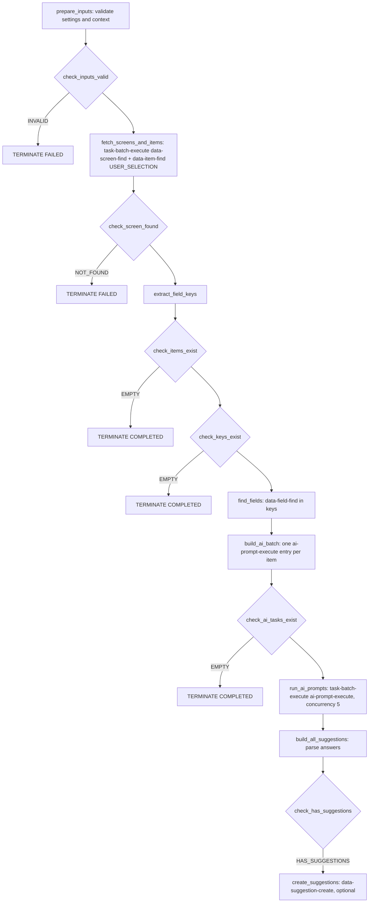

# Detect typos with AI and create suggestions

## Purpose

Select items in the grid, launch the job: the fields flagged with a metadata key are sent to an AI model to be read for spelling mistakes, and each item whose answer carries a correction receives one suggestion holding the corrected values. No value changes until someone accepts a suggestion.

This is the reference "AI suggestion job" skeleton: prepare and validate, fetch in parallel, guard, build a batch of prompts, run the batch, parse, create. The provider and the model are settings of the first task, so the same package runs on OpenAI, Mistral or Anthropic.

Patterns shown:

- settings in `prepare_inputs.inputParameters.data` rather than in `userInputs`, validated by a script, with `SWITCH` + `TERMINATE` guards (`FAILED` for a configuration error, `COMPLETED` for an empty selection);
- the launch context: `context.view.table.id` and `context.view.screen.id` (no `tableKey` setting: the job runs on the table it is launched from);
- `task-batch-execute` twice: once with two different finds (`concurrency: 2`), once with a single `taskName` and a task list built by a script (`request.json: ${build_ai_batch.output.result.tasks}`);
- `ai-prompt-execute` inputs (`provider`, `model`, `apiKey`, `prompt`, `responseFormat: json_object`, `maxTokens`) and a prompt template asset with a `{{FIELDS}}` placeholder;
- `data-field-find` with an `in` criteria to read field metadata;
- `data-suggestion-create` with `suggestion_create` operations, declared `optional` so that a creation failure does not fail the run;

## Prerequisites

| Kind | Key | Notes |
| -- | -- | -- |
| Table and screen | any | The job runs on the table and screen it is launched from. |
| Field metadata | `ai-agent-check-typo` | Set `{"ai-agent-check-typo": true}` (boolean `true` or the string `"true"`) on the definition of every text field to check. Flag text fields only: the job does not check field types. |
| Global variable | `ai_api_key` | Secret: yes. The API key of the chosen provider, without the `Bearer` prefix. The key is written into each batch entry, so treat execution details as sensitive even though the variable is protected. |
| Pipeline | a dedicated one if possible | AI calls are slow; a dedicated pipeline keeps them from delaying imports. |
| Alpha tasks | `ai-prompt-execute`, `task-batch-execute`, `code-execute-javascript`, `data-*` | Recent tasks (alpha in the documentation), available on every account. |

## User inputs

None. The items come from the grid selection (`data-item-find` with `findMode: USER_SELECTION`), the table and screen from the launch context. The settings live in the `data` of `prepare_inputs`:

| Setting | Default | Description |
| -- | -- | -- |
| `provider` | `mistral` | `openai`, `mistral` or `anthropic` |
| `model` | `mistral-small-latest` | A model served by that provider (a name that clearly belongs to another provider fails the task before the call) |
| `suggestionName` | `AI - Typo detection` | Emitter name shown on the suggestion |
| `metadataKey` | `ai-agent-check-typo` | Metadata key marking the fields to check |
| `context` | `${workflow.input.context}` | Leave as is |

## Flow

## Tasks

| # | Task reference | Catalog task | Role |
| -- | -- | -- | -- |
| 1 | `prepare_inputs` | `code-execute-javascript` | Validate the settings, read the table and screen ids from the context |
| 2 | `check_inputs_valid` | `switch` + `terminate` | Stop in error when something is missing, listing what |
| 3 | `fetch_screens_and_items` | `task-batch-execute` | Find the launch screen (`data-screen-find` by id) and the selected items (`data-item-find`, `USER_SELECTION`, JSON attachment) in parallel |
| 4 | `check_screen_found` | `switch` + `terminate` | Stop in error when the screen lookup came back empty |
| 5 | `extract_field_keys` | `code-execute-javascript` | Unique field keys of the selection, item count |
| 6 | `check_items_exist` | `switch` + `terminate` | Complete when nothing is selected |
| 7 | `check_keys_exist` | `switch` + `terminate` | Complete when the selection carries no value |
| 8 | `find_fields` | `data-field-find` | Definitions of those keys (`in` criteria, `context.tableId`) |
| 9 | `build_ai_batch` | `code-execute-javascript` | Keep the flagged fields holding a value, build one entry per item from `assets/prompt-template.txt` |
| 10 | `check_ai_tasks_exist` | `switch` + `terminate` | Complete when no entry was built |
| 11 | `run_ai_prompts` | `task-batch-execute` | `taskName: ai-prompt-execute`, `concurrency: 5` |
| 12 | `build_all_suggestions` | `code-execute-javascript` | Parse each answer, build `suggestion_create` operations |
| 13 | `check_has_suggestions` | `switch` + `data-suggestion-create` | Create every suggestion in one call, only if there is at least one |

What the model is asked: the prompt built from `assets/prompt-template.txt`, where `{{FIELDS}}` is replaced by the item's flagged fields as JSON (key, type, value). It asks for spelling mistakes only and for an answer shaped `{"corrections": [{"fieldKey", "fieldType", "correctedValue"}]}`, empty when nothing is wrong. The call uses `responseFormat: json_object` and `maxTokens: 1024`; `temperature` is not set because several current models reject it. `maxTokens` bounds the answer: an item with many long fields can get an answer cut mid-JSON, which counts as an error for that item.

## Outputs

| Output | Meaning |
| -- | -- |
| `itemsProcessed` | Selected items read |
| `itemsAnalyzed` | Items sent to the model |
| `itemsSkipped` | Items with no flagged field holding a value |
| `suggestionsCreated` | Corrected values, summed over items (one suggestion with three corrections counts three) |
| `aiErrors` | Answers that could not be used (failed request, empty, not JSON, wrong shape) |

When a guard terminates the run, the `message` of that `TERMINATE` task is what the user sees.

| Situation | Result |
| -- | -- |
| Typos found | One suggestion per item, holding one proposed value per corrected field |
| No item selected, or no value, or no flagged field | The run completes without an AI request and says why |
| The model found nothing | No suggestion for that item; the answer still counts as read |
| A request failed or the answer could not be read | No suggestion for that item, counted in `aiErrors`; other items unaffected |
| Suggestion creation fails | The run still completes (`create_suggestions` is optional) |

## How to import

1. Create the protected global variable `ai_api_key` in settings.product-live.com > **Data Factory > Variables**.
2. Flag the fields to check with the metadata `ai-agent-check-typo` set to `true` (table settings > fields > metadata).
3. Optionally edit the `data` of `prepare_inputs` in `job.json` (provider, model).
4. Package the folder as a `.job.zip` (VS Code: right-click `job.json` > **Package Job**; or `node <path-to-skills>/pl-job-build/scripts/package-job.js ai-typo-detection-suggestions`).
5. In settings.product-live.com > **Data Factory > Jobs**, click **Add job**, drop the archive, choose the pipeline, set the visibility to the tables to check.
6. In app.product-live.com, open a table, select items, click **Actions > Detect typos with AI and create suggestions**, run, then review the suggestions panel.

## Adapting

- Another provider: set `provider` and `model` in `prepare_inputs`; the variable `ai_api_key` holds that provider's key. A second provider can use a second variable: change the `apiKey` expression of `build_ai_batch` accordingly (one global variable per template string).
- Another check (translation, enrichment, classification): change `prompt-template.txt`, the metadata key, and the parsing in `build-all-suggestions.js`; keep the skeleton.
- Keep the key out of the scripts: pass `apiKey` directly in each batch entry only because the batch is built by a script; a job calling `ai-prompt-execute` once should put `${workflow.globalVariables.ai_api_key}` straight in that task's `apiKey` input.
- Throughput: `concurrency` is capped at 5 by `task-batch-execute`; for hundreds of items, split the selection or loop over pages.
- Long selections: raise the job-level `timeoutSeconds` (1800 here).
