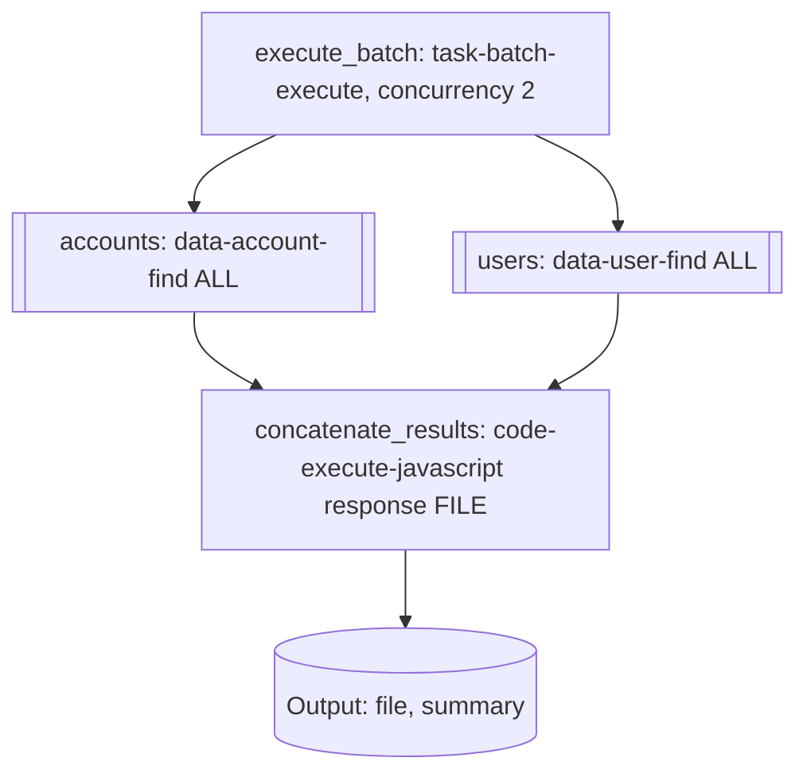

# Run two finds in parallel with task-batch-execute

## Purpose

The smallest `task-batch-execute` job: two independent finds (`data-account-find` and `data-user-find`) run as one batch step with two parallel slots, then a script merges both result lists into a single JSON file. Use it to learn the shape of a batch request and of its result list before writing a fan-out of HTTP calls, scripts or AI prompts.

Patterns shown:

- an inline batch (`request.method: INLINE`, `request.json.tasks[]`) mixing two different task names, each entry carrying a `key` and the `inputs` the task would receive in its own `inputParameters`;
- `concurrency` (1 to 5 parallel slots, entries run sequentially inside a slot);
- reading the result list (`${execute_batch.output.result.json}`, always in input order) and the `summary` object;
- post-processing the list with `code-execute-javascript` and `response: FILE`.

## Prerequisites

| Kind | Key | Notes |
| -- | -- | -- |
| Pipeline | any | Assigned in Settings when the job is imported. |
| Permissions | read accounts and users | Both finds run with the credentials of the job execution. |
| Alpha tasks | `task-batch-execute`, `code-execute-javascript`, `data-*` | Recent tasks (alpha in the documentation), available on every account. Neither `data-account-find` nor `data-user-find` is on the list of tasks excluded from batches (`table-import-schema`, for example, is). |

No table, no variable, no input.

## User inputs

None.

## Flow



## Tasks

| # | Task reference | Catalog task | Role | Key inputs |
| -- | -- | -- | -- | -- |
| 1 | `execute_batch` | `task-batch-execute` | Two finds in parallel | `concurrency: 2`, `request.json.tasks: [{key: accounts, taskName: data-account-find, inputs: {...}}, {key: users, taskName: data-user-find, inputs: {...}}]`, `outputs: [{outputKey: json, outputMode: INLINE, mediaType: application/json}]` |
| 2 | `concatenate_results` | `code-execute-javascript` | Merge the two lists | `data.results: ${execute_batch.output.result.json}`, `response: FILE`, `outputFileName: accounts-and-users.json` |

The batch result list, one entry per batch task:

```json
{
    "result": {
        "json": [
            { "key": "accounts", "index": 0, "status": "COMPLETED", "success": true, "output": { "totalElements": 3, "result": { "json": [] } } },
            { "key": "users", "index": 1, "status": "COMPLETED", "success": true, "output": { "totalElements": 7, "result": { "json": [] } } }
        ]
    },
    "summary": { "total": 2, "successCount": 2, "errorCount": 0, "durationMs": 1200 }
}
```

`assets/concatenate-results.js` walks that list, reads the entities of each find in `output.result.json` and returns the merged document:

```json
{
    "totalElements": 10,
    "failedTasks": [],
    "sections": {
        "accounts": { "totalElements": 3, "elements": [] },
        "users": { "totalElements": 7, "elements": [] }
    }
}
```

A batch task that fails does not stop the others: it is listed in `failedTasks` and counted in `summary.errorCount`.

## Outputs

| Output | Source | Content |
| -- | -- | -- |
| `file` | `${concatenate_results.output.result}` | The merged JSON file `accounts-and-users.json` |
| `summary` | `${execute_batch.output.summary}` | `total`, `successCount`, `errorCount`, `durationMs` |

## How to import

1. Package the folder as a `.job.zip` (VS Code: right-click `job.json` > **Package Job**; or `node <path-to-skills>/pl-job-build/scripts/package-job.js batch-execute-parallel`).
2. In settings.product-live.com > **Data Factory > Jobs**, click **Add job**, drop the archive, choose a pipeline.
3. Click **Run** on the job and download `file` from the execution.

## Adapting

- Same task N times: set a top-level `taskName` and omit it in the entries (for example `taskName: protocol-http-perform` with one entry per URL, or `ai-prompt-execute` with one prompt per item as in `ai-typo-detection-suggestions`).
- List built at runtime: have a `code-execute-javascript` task return `{ tasks: [...] }` and inject it whole: `"json": "${build_tasks.output.result}"`. Never leave a placeholder string where a task list is expected: the job creation fails.
- Large results: ask the batch for `outputMode: ATTACHMENT` and read the file with a `resources` entry in the script.
- Dependent steps: when each iteration needs the previous one, use the `loop` task instead of a batch.
