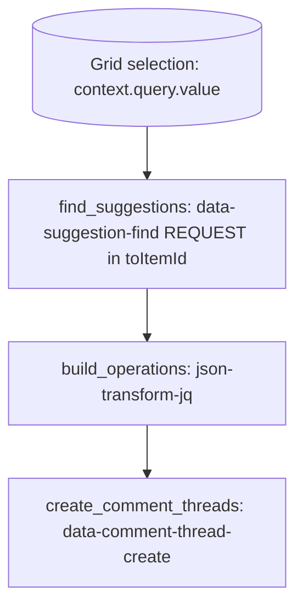

# Comment on multiple items

## Purpose

The user selects items in the grid, types a message, and the job opens one comment thread per suggestion attached to those items. Three tasks, no asset: the canonical "find, build operations with jq, bulk create" pattern used by every mass action on Product-Live data.

Patterns shown:

- reading the grid selection from the launch context: `${workflow.input.context.query.value}` is the array of selected item ids when the job is launched with items selected (`queryMode: API_V1`);
- `data-suggestion-find` in `REQUEST` mode with an `in` criteria fed by an array expression;
- `json-transform-jq` turning a list into `{ operations: [{ key, element }] }` with `to_entries` and `map`;
- `data-comment-thread-create` consuming the operations object injected whole (`"operations": "${build_operations.output.result.operations}"`).

## Prerequisites

| Kind | Key | Notes |
| -- | -- | -- |
| Table | any | Launch the job from a table whose items carry suggestions (threads attach to suggestions, not directly to items). |
| Pipeline | any | Assigned in Settings when the job is imported. |
| Launch origin | app.product-live.com, with items selected | With no selection the context carries no `query`, and the find has nothing to match. |

No variable. The `data-*` tasks are recent tasks (alpha in the documentation), available on every account.

## User inputs

| Key | Type | Required | Default | Description |
| -- | -- | -- | -- | -- |
| `comment` | `TEXT` | yes | `Hello` | Message posted on every thread |

## Flow



## Tasks

| # | Task reference | Catalog task | Role | Key inputs |
| -- | -- | -- | -- | -- |
| 1 | `find_suggestions` | `data-suggestion-find` | Suggestions of the selected items | `findMode: REQUEST`, criteria `in toItemId`, `value: ${workflow.input.context.query.value}` |
| 2 | `build_operations` | `json-transform-jq` | One `comment_thread` operation per suggestion | `data: {message, suggestions}`, `queryExpression` (see `job.json`) |
| 3 | `create_comment_threads` | `data-comment-thread-create` | Bulk create | `request.json.operations: ${build_operations.output.result.operations}` |

The jq expression:

```jq
.data.message as $msg
| { operations: (.data.suggestions | to_entries | map({
      key: ((.key + 1) | tostring),
      element: { object: "comment_thread", targetType: "suggestion", targetId: .value.id, comments: [{ message: $msg }] }
  })) }
```

## Outputs

| Output | Source | Content |
| -- | -- | -- |
| `suggestions_found` | `${find_suggestions.output.totalElements}` | Number of suggestions found, hence of threads created |
| `threads` | `${create_comment_threads.output.result.json}` | Result of the create call (one entry per operation) |

## How to import

1. Package the folder as a `.job.zip` (VS Code: right-click `job.json` > **Package Job**; or `node <path-to-skills>/pl-job-build/scripts/package-job.js comment-on-multiple-items`).
2. In settings.product-live.com > **Data Factory > Jobs**, click **Add job**, drop the archive, choose a pipeline and set the visibility to the tables where it must appear.
3. In app.product-live.com, select items that have suggestions, click **Actions > Comment on multiple items**, type the message and run.

## Adapting

- Older jobs read the selection with `${workflow.input.context.selection.ids}`; that property is deprecated in favour of `query` (`queryMode: API_V1`). When the grid filter cannot be expressed as a query (`queryMode: LEGACY`), only the legacy `selection` is available: use `data-item-find` with `findMode: USER_SELECTION` to get the items, then map their ids in jq.
- Reply on existing threads instead of opening new ones: find the threads with `data-comment-thread-find` and use `data-comment-thread-create-reply`.
- Guard against an empty result: add a `SWITCH` on `${find_suggestions.output.totalElements}` with a `TERMINATE COMPLETED` branch before the create task.
