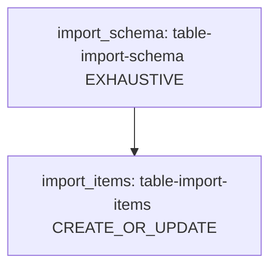

# Demo products table

## Purpose

Creates the `PL_DEMO_PRODUCTS` table (one `PRODUCT` level, partitions `ACTIVES` and `ARCHIVED`, identifier `EAN_13`, classification `TYPOLOGY`, a few dozen fields covering every data type) and imports 20 demo products into it.

The 20 demo products (5 washing machines, 11 fridges, 4 laptops) are invented: their EAN-13 codes come from the GS1 restricted-circulation range (prefix `200`, valid check digit, from `2000000000015` to `2000000000206`), and their titles and descriptions name no brand or model. A few items deliberately break a rule of the `DATA_COMPLIANCE` conditional formatting (an empty English title, main view or battery capacity, an English title longer than 40 characters), so that column shows every status.

Every other example of this library that needs a table (CSV and JSON imports, Excel export, search across partitions, nightly SFTP import) is written against this fixture. Run this job first on a test account, then try the others.

Patterns shown:

- table bootstrap: `table-import-schema` in `EXHAUSTIVE` mode followed by `table-import-items`;
- the schema XML vocabulary (`Table/Schema/Levels`, `Partitions`, `Identifiers`, `Classifications`, `Fields`, `Screens`) and the items XML vocabulary (`Table/Items/Item/Identifier|Classification|Field`);
- shipped files referenced with bare `file://assets/<path>` strings.

## Prerequisites

| Kind | Key | Notes |
| -- | -- | -- |
| Table | `PL_DEMO_PRODUCTS` | Created by this job. In `EXHAUSTIVE` mode the schema file is the complete definition: any element of the table that is not in the file is archived. Do not run it on a table you have customised. |
| Pipeline | any | Assigned in Settings when the job is imported. |

No variable. No launch context needed (the job can be run from Settings).

The image and attachment fields of the demo items (`MAIN_VIEW`, `FRONT_VIEW`, `BACK_VIEW`, `LEFT_VIEW`, `RIGHT_VIEW`, `ENERGY_LABEL`, `INSTALLATION_DIAGRAM`, `IN_SITUATION_1`, `IN_SITUATION_2`, `INSTRUCTIONS`) point to `https://example.com/...` placeholders. The import task downloads image and attachment values from public URLs, so expect those fields not to be imported (check the items report); the text, number, date and select fields are imported normally. Replace the placeholders with public URLs of your own, or delete those `<Field>` elements, if you want media on the demo items.

## User inputs

None.

## Flow

## Tasks

| # | Task reference | Catalog task | Role | Key inputs |
| -- | -- | -- | -- | -- |
| 1 | `import_schema` | `table-import-schema` | Create or update the table from `assets/table.xml` | `request: file://assets/table.xml`, `mode: EXHAUSTIVE` |
| 2 | `import_items` | `table-import-items` | Import the 20 demo products | `request: file://assets/items.xml`, `mode: CREATE_OR_UPDATE` |

## Outputs

| Output | Source | Content |
| -- | -- | -- |
| `schema_report` | `${import_schema.output.report}` | XML report of the schema import |
| `items_report` | `${import_items.output.report}` | XML report of the items import (one `Log` per rejected item or value) |

## How to import

1. Package the folder as a `.job.zip`: in VS Code with the Product-Live extension, right-click `job.json` and choose **Package Job**, or run `node <path-to-skills>/pl-job-build/scripts/package-job.js demo-products-table`.
2. In settings.product-live.com, open **Data Factory > Jobs**, click **Add job**, drop the archive, choose a pipeline and a project, keep the status **Draft** while testing.
3. Click **Run** on the job (no input is required), then open the execution to read the two reports.
4. Open app.product-live.com: the table **Products (Demo)** now lists the demo items.

## Adapting

- To use your own table, replace `assets/table.xml` with an export of your schema (`table-export-schema`) and `assets/items.xml` with your items; keep the `Table/@key` of both files identical.
- Switch `mode` of `import_schema` to `INCREMENTAL` (the default) if you only want to add fields, options or categories to an existing table: in `EXHAUSTIVE` mode "any element not present in the request document will be archived".
- Set `mode: CREATE_ONLY` on `import_items` if a rerun must never overwrite values edited in the application.
