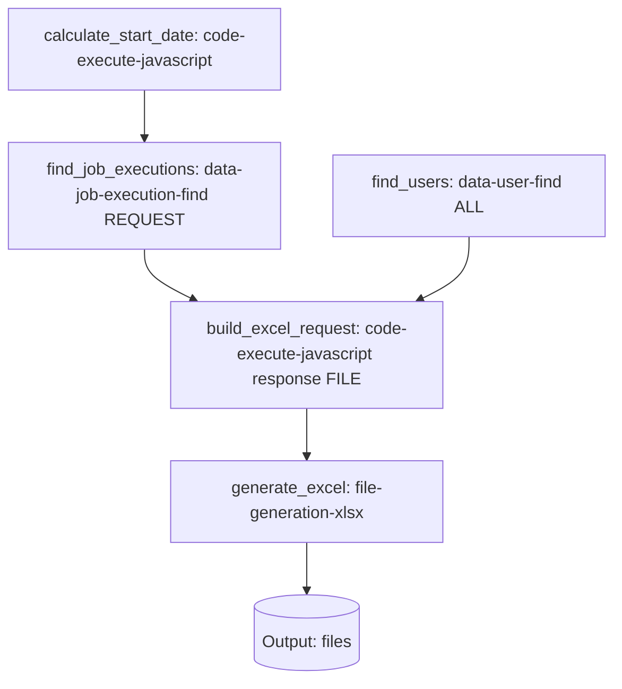

# Export job executions to Excel

## Purpose

Produces an Excel report of every job execution of the account over the last N days: job name, status, start and end times, duration, and the user who launched it. A convenient monitoring report for Data Factory administrators, and the cleanest example of the "API find, JavaScript, Excel" pipeline: no XSLT, the `Generate-Excel` request is built by a script.

Patterns shown:

- a `TEXT` user input with a default, parsed by a script (TEXT values are always strings);
- `data-job-execution-find` in `REQUEST` mode with a `criteria` (`greater` on `createdAt`) and `options` (sort);
- `data-user-find` in `ALL` mode;
- `outputs[].outputMode: ATTACHMENT` so large result lists travel as files, then `resources[].loadAs: JSON` in the script;
- `code-execute-javascript` with `response: FILE` returning an XML string;
- `file-generation-xlsx` with a single template.

## Prerequisites

| Kind | Key | Notes |
| -- | -- | -- |
| Pipeline | any | Assigned in Settings when the job is imported. |
| Permissions | read job executions and users | The finds run with the credentials of the job execution. |

No table, no variable. The job can be launched from Settings or scheduled.

## User inputs

| Key | Type | Required | Default | Description |
| -- | -- | -- | -- | -- |
| `days` | `TEXT` | yes | `30` | Number of days to look back. Invalid values fall back to 30. |

## Flow

## Tasks

| # | Task reference | Catalog task | Role | Key inputs |
| -- | -- | -- | -- | -- |
| 1 | `calculate_start_date` | `code-execute-javascript` | Compute `startDateISO` and `daysRequested` | `expressionFile: file://assets/calculate-date.js`, `data.days: ${workflow.input.days}` |
| 2 | `find_job_executions` | `data-job-execution-find` | Executions created after the start date | `findMode: REQUEST`, criteria `greater createdAt`, sort `createdAt DESC`, output `ATTACHMENT json` |
| 3 | `find_users` | `data-user-find` | All users of the account | `findMode: ALL`, output `ATTACHMENT json` |
| 4 | `build_excel_request` | `code-execute-javascript` | Join both lists and write the `Generate-Excel` XML | `resources: executions, users (loadAs JSON)`, `response: FILE`, `outputFileName: generate-excel-request.xml` |
| 5 | `generate_excel` | `file-generation-xlsx` | Render the workbook | `request: ${build_excel_request.output.result}`, template `report` |

## Outputs

| Output | Source | Content |
| -- | -- | -- |
| `files` | `${generate_excel.output.files}` | The workbook `job-executions-report.xlsx` |
| `executions_found` | `${find_job_executions.output.totalElements}` | Number of executions in the report |

## How to import

1. Package the folder as a `.job.zip` (VS Code: right-click `job.json` > **Package Job**; or `node <path-to-skills>/pl-job-build/scripts/package-job.js export-job-executions-to-excel`).
2. In settings.product-live.com > **Data Factory > Jobs**, click **Add job**, drop the archive, choose a pipeline. Visibility can stay **Hidden for all tables**: the job is meant for administrators.
3. Click **Run** on the job, enter the number of days, then download the workbook from the execution.
4. Optional: schedule it (job settings > periodicity, for example `0 6 * * 1` for a weekly report on Monday 06:00 UTC); periodic runs use the input default.

## Adapting

- Filter on a status: add a second criteria (for example `{"type": "in", "field": "status", "value": ["FAILED", "USER_ERROR"]}`) combined with the date criteria; see the `criteria` syntax in the reference.
- Other columns: edit the `headers` array and the row cells in `assets/build-excel-request.js`; the template only styles the header row.
- Email the report: add a `code-execute-javascript` task producing an HTML file with `<meta name="pl-mail-to">` and `<meta name="pl-mail-attachments">` (attachment URL from `${generate_excel.output.listing}`), then `notification-send-email`.
- Several sheets: emit several `<Sheet>` elements in the request; sheet names are limited to 31 characters.
