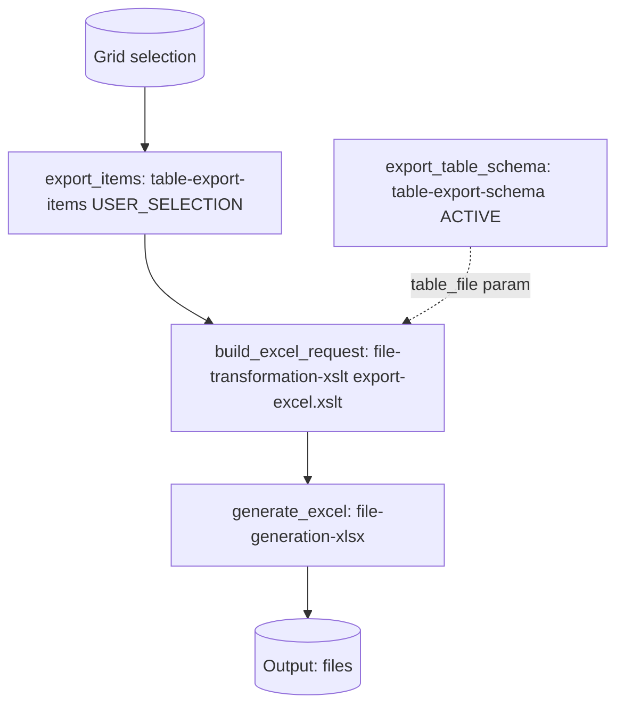

# Export selection to Excel

## Purpose

The flagship export pipeline: the user selects items in the grid and gets one Excel workbook per category (or a single workbook), with one column per field and one row per item, columns ordered like the first screen of the table. It is the pattern behind every "export to Excel" job: export the items, export the schema, build a `Generate-Excel` request with an XSLT, render it with `file-generation-xlsx` and templates.

Patterns shown:

- `table-export-items` in `USER_SELECTION` mode (the job must be launched from the grid with items selected);
- `table-export-schema` in `ACTIVE` mode passed to the XSLT as a file parameter (`document($table_file)`);
- a `SELECT` user input with localised titles, consumed as an XSLT parameter;
- the table key read from a global variable, so the same package serves several tables;
- `file-generation-xlsx` with two templates selected by `<Template-Key>` in the request.

## Prerequisites

| Kind | Key | Notes |
| -- | -- | -- |
| Table | any | The table to export, for example `PL_DEMO_PRODUCTS` from the `demo-products-table` example. |
| Global variable | `excel_export_table_key` | Key of the table to export. Not secret. Created in settings.product-live.com > **Data Factory > Variables**, or overridden per job in the job's **Inputs and variables** section. |
| Pipeline | any | Assigned in Settings when the job is imported. |
| Launch origin | app.product-live.com | `USER_SELECTION` only works when the job is launched from the grid with a selection; it cannot run periodically. |

## User inputs

| Key | Type | Required | Default | Description |
| -- | -- | -- | -- | -- |
| `output_file_type` | `SELECT` (`SINGLE`) | yes | `one_file_per_category` | `one_file_per_category`: one workbook per classification category found in the selection; `one_file`: a single workbook holding every field of the selected categories. |

## Flow

## Tasks

| # | Task reference | Catalog task | Role | Key inputs |
| -- | -- | -- | -- | -- |
| 1 | `export_items` | `table-export-items` | Export the selected items as `items.xml` | `tableKey: ${workflow.globalVariables.excel_export_table_key}`, `mode: USER_SELECTION` |
| 2 | `export_table_schema` | `table-export-schema` | Export the active schema | same `tableKey`, `mode: ACTIVE`, `fileName: table.xml` |
| 3 | `build_excel_request` | `file-transformation-xslt` | Build the `Generate-Excel` document | `file: ${export_items.output.file}`, `xslt: file://assets/1-xslt/export-excel.xslt`, params below |
| 4 | `generate_excel` | `file-generation-xlsx` | Render the workbooks | `request: ${build_excel_request.output.file}`, templates `template` and `template_large_rows` |

XSLT parameters (the header comment of `assets/1-xslt/export-excel.xslt` is the full reference):

| Parameter | Passed by the job | Meaning |
| -- | -- | -- |
| `table_file` | `${export_table_schema.output.file}` | Required. Schema file read with `document()`. |
| `output_file_type` | `${workflow.input.output_file_type}` | Required. `one_file_per_category` or `one_file`. |
| `columns_include_medias` | `no` | Include `IMAGE` and `ATTACHMENT` columns. |
| `columns_keep_empty_columns` | `no` | Keep columns that no selected item fills. |
| `columns_include_specifics_fields` | `yes` | Include the category-specific fields. |
| `output_only_data_structure` | `no` | `yes` exports an empty matrix (headers only). |
| `columns_ignored_fields_keys`, `output_file_name`, `screen_key`, `screen_exhaustive`, `misc_languages`, `misc_classificationKey`, `misc_display_suffixes`, `misc_display_images`, `misc_multi_values_separator` | not passed (defaults) | See the stylesheet header. Add a `params` entry to set one. |

Note on literal parameters: how the platform evaluates `params[].select` is not documented. The public task reference says a static string "must be encapsulated in simple quotes", but its own example passes a bare value (`"select": "red"`), and this job passes `yes` and `no` bare (the stylesheet also normalises them with `normalize-space(upper-case(...))`). The documentation shows both forms; prefer bare values (`"select": "yes"`) for every new parameter. A quoted value is not portable: the platform's handling of the apostrophes is not documented, and the local runners do not all treat them the same way.

Media links: with `columns_include_medias: yes`, the `IMAGE` and `ATTACHMENT` cells hold the links exactly as `table-export-items` provides them, as link cells or, for images when `misc_display_images` is `yes`, as image cells. The stylesheet never rewrites a link; `file-generation-xlsx` fits each image to the space of its cell.

## Outputs

| Output | Source | Content |
| -- | -- | -- |
| `files` | `${generate_excel.output.files}` | The generated workbooks (one per category, or one) |

## How to import

1. Create the global variable `excel_export_table_key` in settings.product-live.com > **Data Factory > Variables** with the key of your table (for the demo table: `PL_DEMO_PRODUCTS`).
2. Package the folder as a `.job.zip` (VS Code: right-click `job.json` > **Package Job**; or `node <path-to-skills>/pl-job-build/scripts/package-job.js export-selection-to-excel`).
3. In settings.product-live.com > **Data Factory > Jobs**, click **Add job**, drop the archive, choose the pipeline and set the visibility to the table.
4. In app.product-live.com, select a few items in the grid, click **Actions > Export selection to Excel**, choose the output type and run; download the workbooks from the result panel.

## Adapting

- Several tables: import the package once per table and override `excel_export_table_key` in each job's **Inputs and variables** section, or replace the variable by a `SELECT` user input of table keys.
- Column order: pass `screen_key` to order the columns like a given screen, and `screen_exhaustive: yes` to restrict the export to the columns of that screen.
- Whole table instead of the selection: set `mode: ALL` on `export_items`; the job can then be scheduled.
- Look and feel: edit the two templates in `assets/2-template/` (styles of the header row and of the data rows); `template_large_rows` is used by the stylesheet for sheets with tall rows.
- Matrix for data entry: set `output_only_data_structure` to `yes` to produce a workbook with headers only.
- Export of the current screen: the stylesheet reads screen columns only inside sections and never expands a `Column-Composite` column into its sub-columns. To follow the screen the user launched the job from, pass `${workflow.input.context.view.table.key}` as the `tableKey` of both export tasks and `${workflow.input.context.view.screen.key}` as the `screen_key` parameter, then adapt the stylesheet to read columns both inside and outside sections and the sub-columns of each composite column both inside its `Section` elements and directly under it, tolerating a composite column that lists none (not documented). A user's private screen settings (hidden, pinned or reordered columns) are not in the documented launch context, so the export cannot follow them.
