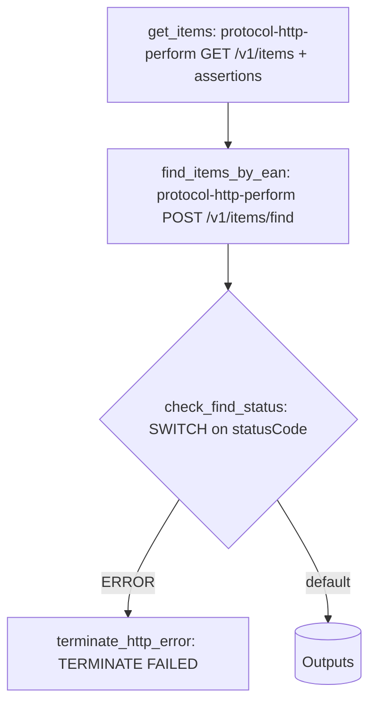

# Call an HTTP API

## Purpose

Two `protocol-http-perform` calls that show the essentials of the HTTP task: a `GET` with query parameters and assertions, and a `POST` with a JSON body followed by a `SWITCH` on the status code. The calls target the Product-Live API itself with `PL_KEY` authentication, which generates an ephemeral API key for the user who launched the job: no key to store, no variable to create.

Patterns shown:

- the `domain` / `path` / `method` / `headers` / `queryParameters` envelope (`domain` without scheme, port or path);
- `authentication: {useAuthentication: true, type: PL_KEY}`;
- explicit `connectionTimeOutMilliseconds` and `readTimeOutMilliseconds` (the documented default read timeout is very low);
- `responses: ["JSON"]` and the `${ref.output.response.json}` path;
- `assertions` with `failOnError: true` versus a `SWITCH` on `${ref.output.statusCode}`: the task succeeds as soon as it got a response, whatever the status code, so one of the two is needed when a bad status must stop the job;
- `retrySettings` with exponential backoff;
- diagnostic outputs (`reasonPhrase`, `curl` with obfuscated keys, `responseTimeMs`) surfaced in a `TERMINATE` message.

## Prerequisites

| Kind | Key | Notes |
| -- | -- | -- |
| Pipeline | any | Assigned in Settings when the job is imported. |
| Permissions | read items | The ephemeral key acts on behalf of the user who started the job. |

No table required by the job itself (the `find` call looks for an EAN of the demo table and returns an empty result otherwise), no variable, no input. To call another API with a stored secret, see Adapting.

## User inputs

None.

## Flow

## Tasks

| # | Task reference | Catalog task | Role | Key inputs |
| -- | -- | -- | -- | -- |
| 1 | `get_items` | `protocol-http-perform` | `GET https://api.product-live.com/v1/items?page=1&size=10` | `headers.Accept`, `queryParameters`, `authentication PL_KEY`, timeouts, `responses: [JSON]`, `assertions` (status 200, content-type contains `application/json`), `failOnError: true` |
| 2 | `find_items_by_ean` | `protocol-http-perform` | `POST https://api.product-live.com/v1/items/find` | `body: {type: JSON, json: {keyName: EAN_13, stringEquals: [...]}}`, `authentication PL_KEY`, `retrySettings: {maxRetries: 2, retryDelayMs: 1000, backoffStrategy: EXPONENTIAL}` |
| 3 | `check_find_status` | `switch` | Guard on the status code | `evaluatorType: javascript`, `expression: $.statusCode == 200 ? 'OK' : 'ERROR'` |
| 3a | `terminate_http_error` | `terminate` | Stop in error with the status and the cURL command | `terminationStatus: FAILED`, `outputParameters.message`, `outputParameters.curl` |

## Outputs

| Output | Source | Content |
| -- | -- | -- |
| `get_status_code` | `${get_items.output.statusCode}` | HTTP status of the GET |
| `get_response` | `${get_items.output.response.json}` | JSON body of the GET |
| `find_status_code` | `${find_items_by_ean.output.statusCode}` | HTTP status of the POST |
| `find_response` | `${find_items_by_ean.output.response.json}` | JSON body of the POST |
| `find_response_time_ms` | `${find_items_by_ean.output.responseTimeMs}` | Duration of the POST |

## How to import

1. Package the folder as a `.job.zip` (VS Code: right-click `job.json` > **Package Job**; or `node <path-to-skills>/pl-job-build/scripts/package-job.js http-api-call`).
2. In settings.product-live.com > **Data Factory > Jobs**, click **Add job**, drop the archive, choose a pipeline.
3. Click **Run** on the job and open the execution: each HTTP task shows its status code, headers, body and the cURL command to reproduce the request.

The two endpoints (`/v1/items`, `/v1/items/find`) are the ones used in the public documentation of the task; check the API reference of api.product-live.com for the exact query parameters and body accepted by your account.

## Adapting

- Another API with a secret: store the key in a protected global variable and use `authentication: {type: API_KEY, apiKey: "${workflow.globalVariables.my_api_key}", headerName: "X-Api-Key"}`, or `type: BEARER` with `token`, or `type: BASIC`, or `OAUTH2_CLIENT_CREDENTIALS` with `tokenUrl`, `clientId`, `clientSecret`. Never write a key in `job.json`.
- Download a file: set `responses: ["FILE"]` and pass `${call.output.response.file}` to the next task (`file-transformation-xslt`, `table-import-items`, `file-conversion-unarchive`).
- Send a file: `body: {type: BINARY_FILE, file: "file://assets/..."}` or `type: MULTIPART_FORM` with a `form` array; `type: PLAIN` with `contentType` for XML or CSV text.
- Many calls: build the list of calls with a script and run them with `task-batch-execute` (`taskName: protocol-http-perform`, `concurrency` up to 5); see `batch-execute-parallel`.
- Reshape the JSON answer: feed `${call.output.response.json}` to `json-transform-jq` or `code-execute-javascript`, or convert it with `file-conversion-json-to-xml` for an XSLT.
