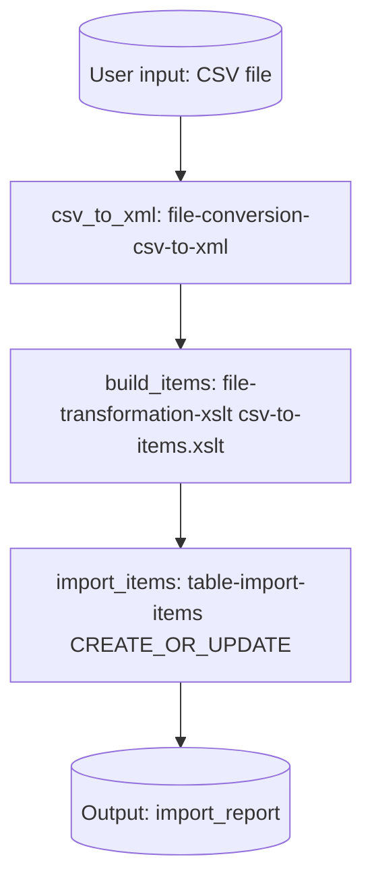

# Import items from a CSV file

## Purpose

The simplest complete import pipeline: a user uploads a CSV file, the job converts it to XML, maps the columns to item fields with an XSLT and imports the result into the demo table. The import report is exposed as a job output.

Patterns shown:

- `FILE` user input wired directly to a task (`"file": "${workflow.input.file}"`);
- `file-conversion-csv-to-xml` and its `Csv-To-Xml/File/Rows/R[@i]/C[@j]` grid;
- a header-driven XSLT (the first row gives the field keys) producing the `Table/Items/Item` document;
- `table-import-items` with an explicit `mode`, and the `report` output.

## Prerequisites

| Kind | Key | Notes |
| -- | -- | -- |
| Table | `PL_DEMO_PRODUCTS` | Created by the `demo-products-table` example. Partition `ACTIVES`, identifier `EAN_13`, classification `TYPOLOGY`. |
| Pipeline | any | Assigned in Settings when the job is imported. |

No variable.

## User inputs

| Key | Type | Required | Default | Description |
| -- | -- | -- | -- | -- |
| `file` | `FILE` | yes | none | Semicolon-separated UTF-8 CSV with a header row. |

## Flow

## Tasks

| # | Task reference | Catalog task | Role | Key inputs |
| -- | -- | -- | -- | -- |
| 1 | `csv_to_xml` | `file-conversion-csv-to-xml` | Convert the CSV into the generic grid | `mode: FILE`, `file: ${workflow.input.file}`, `columnSeparator: ;`, `textDelimiter: "`, `escapeCharacter: "` |
| 2 | `build_items` | `file-transformation-xslt` | Map the grid to the items document | `file: ${csv_to_xml.output.file}`, `xslt: file://assets/csv-to-items.xslt`, `fileName: items.xml` |
| 3 | `import_items` | `table-import-items` | Create or update the items | `request: ${build_items.output.file}`, `mode: CREATE_OR_UPDATE` |

## Outputs

| Output | Source | Content |
| -- | -- | -- |
| `items_file` | `${build_items.output.file}` | The generated items XML, useful to debug the mapping |
| `import_report` | `${import_items.output.report}` | XML report of the import; each rejected item or value is a `Log` entry with its XPath, code and message |

## How to import

1. Package the folder as a `.job.zip` (VS Code: right-click `job.json` > **Package Job**; or `node <path-to-skills>/pl-job-build/scripts/package-job.js import-items-from-csv`).
2. In settings.product-live.com > **Data Factory > Jobs**, click **Add job**, drop the archive, choose the pipeline, set the visibility to the demo table.
3. From app.product-live.com, open the demo table, click **Actions > Import items from a CSV file**, upload a CSV file and run.
4. Download `import_report` from the execution to check that both items were imported.

## Adapting

- Another table: change the four `xsl:param` defaults at the top of `assets/csv-to-items.xslt` (`table_key`, `partition_key`, `identifier_key`, `classification_key`). The CSV header must use the field keys of that table.
- Comma-separated files: set `columnSeparator` to `,`. Files with no header: replace the header lookup by fixed column numbers (`C[@j = 1]`, `C[@j = 2]`, ...).
- Number fields: values must use `.` as decimal separator; add a `suffix` attribute on the `Field` element when the field carries a unit.
- Images and attachments: the value must be a public URL; add a `file-key` attribute (your ETag or MD5) so a file imported twice is downloaded once.
- Never create items from an enrichment file: set `mode: UPDATE_ONLY` on `import_items`.
- Large or scheduled imports: see the `nightly-sftp-csv-import` example, which reuses this stylesheet behind an SFTP pickup.
