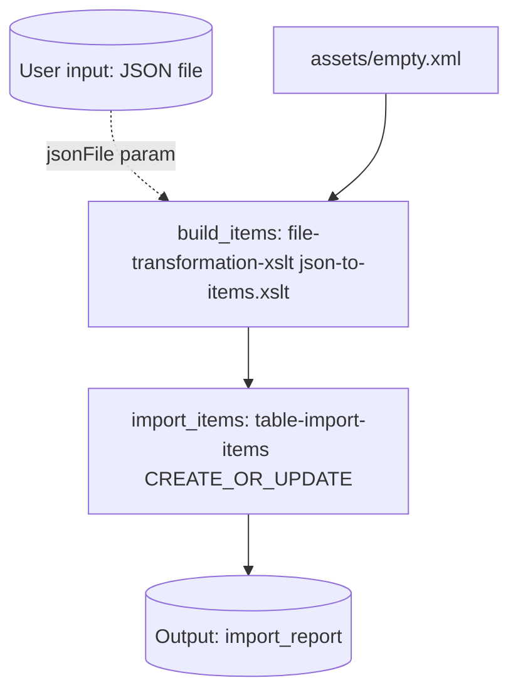

# Import items from a JSON file

## Purpose

Same import pipeline as `import-items-from-csv`, but the source is a JSON file and no conversion task is needed: an XSLT 3.0 stylesheet reads the uploaded file itself with `unparsed-text()` and parses it with `json-to-xml()`. Two tasks are enough.

Patterns shown:

- the "dummy source" trick: `file-transformation-xslt` needs a `file` input, so the job passes `file://assets/empty.xml` and the stylesheet reads its real input from a parameter;
- a `FILE` user input passed as an XSLT `params[].select` value resolves to a URL that `unparsed-text()` (or `document()`) can open;
- the W3C `xpath-functions` vocabulary produced by `json-to-xml()` (`array`, `map`, `string`, `number`, `boolean`, `null`, each with a `@key`);
- fail-fast validation inside the stylesheet with `<xsl:message terminate="yes">`.

## Prerequisites

| Kind | Key | Notes |
| -- | -- | -- |
| Table | `PL_DEMO_PRODUCTS` | Created by the `demo-products-table` example. Partition `ACTIVES`. |
| Pipeline | any | Assigned in Settings when the job is imported. |

No variable.

## User inputs

| Key | Type | Required | Default | Description |
| -- | -- | -- | -- | -- |
| `file` | `FILE` | yes | none | A JSON array of objects, each with `identifiers`, `classification` and `fields` maps. |

## Flow

## Tasks

| # | Task reference | Catalog task | Role | Key inputs |
| -- | -- | -- | -- | -- |
| 1 | `build_items` | `file-transformation-xslt` | Parse the JSON and build the items document | `file: file://assets/empty.xml`, `xslt: file://assets/json-to-items.xslt`, `params: [{name: jsonFile, select: ${workflow.input.file}}]`, `fileName: items.xml` |
| 2 | `import_items` | `table-import-items` | Create or update the items | `request: ${build_items.output.file}`, `mode: CREATE_OR_UPDATE` |

## Outputs

| Output | Source | Content |
| -- | -- | -- |
| `items_file` | `${build_items.output.file}` | The generated items XML |
| `import_report` | `${import_items.output.report}` | XML report of the import |

## How to import

1. Package the folder as a `.job.zip` (VS Code: right-click `job.json` > **Package Job**; or `node <path-to-skills>/pl-job-build/scripts/package-job.js import-items-from-json-file`).
2. In settings.product-live.com > **Data Factory > Jobs**, click **Add job**, drop the archive, choose the pipeline, set the visibility to the demo table.
3. From app.product-live.com, open the demo table, click **Actions > Import items from a JSON file**, upload a JSON file and run.

## Adapting

- Another table: change `table_key` and `partition_key` at the top of `assets/json-to-items.xslt`; the keys inside `identifiers`, `classification` and `fields` must be the keys of that table.
- Another JSON shape: adjust the three `xsl:apply-templates` selections; `json-to-xml()` keeps the nesting of the source, so a nested object is a `j:map`, an array a `j:array`.
- JSON pasted as text instead of a file: declare a `TEXTAREA` input and pass it to the stylesheet with `params[].select: ${workflow.input.json}`; replace `unparsed-text($jsonFile)` by the parameter itself.
- JSON fetched from an API: chain a `protocol-http-perform` task with `responses: ["FILE"]` and pass `${call.output.response.file}` as `jsonFile`.
