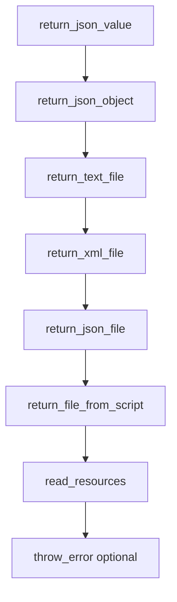

# JavaScript task cheat sheet

## Purpose

A reference job, not a business job: eight tiny `code-execute-javascript` tasks, each showing one way to use the task. Run it once, open the execution, and compare each task's inputs, logs and outputs with the table below.

What the script receives and returns (platform JavaScript sandbox: standard ECMAScript, no network, no modules, 10 minutes per task):

| Element | Meaning |
| -- | -- |
| `$.data` | The `data` object of `inputParameters`, with every `${...}` expression already resolved |
| `$.resources` | Array of `{ key, content }`; `content` is parsed according to `loadAs` (`XML`, `TEXT`, `JSON`) |
| `log(message)` | Writes a line in the task logs |
| `return value` | With `response: JSON` (default), `output.result` is the value; with `response: FILE`, a returned string is written verbatim to `outputFileName`, an object is serialised, and `output.result` is the file |
| `throw new Error(...)` | Fails the task; the job stops unless the task is `optional` |

## Prerequisites

| Kind | Key | Notes |
| -- | -- | -- |
| Pipeline | any | Assigned in Settings when the job is imported. |

No table, no variable, no input. The `code-execute-javascript` task is a recent task (alpha in the documentation), available on every account.

## User inputs

None.

## Flow

The tasks are independent; they run in sequence only because a job is a sequence.

## Tasks

| # | Task reference | Shows | Inputs | Output |
| -- | -- | -- | -- | -- |
| 1 | `return_json_value` | inline `expression`, scalar result | `data: {a: 1}`, `response: JSON` | `output.result` = `1` |
| 2 | `return_json_object` | object result readable as `output.result.<field>` | `data: {a: 1, label: "demo"}` | `{doubled: 2, label: "DEMO"}` |
| 3 | `return_text_file` | `response: FILE` with a string | `outputFileName: test.txt` | file `test.txt` containing `test` |
| 4 | `return_xml_file` | `response: FILE` with an XML string | `outputFileName: test.xml` | file `test.xml` |
| 5 | `return_json_file` | `response: FILE` with an object | `outputFileName: test.json` | file `test.json` containing `{"b":1}` |
| 6 | `return_file_from_script` | `expressionFile` asset + `log()` | `file://assets/return-string.js` | file `greeting.txt` containing `hello world` |
| 7 | `read_resources` | `resources` loaded as XML, TEXT and JSON | three `file://assets/example.*` resources | file `resources.json` echoing the three contents |
| 8 | `throw_error` | expected failure on an `optional` task | `file://assets/throw-error.js`, `data.items: []` | task fails, job continues |

## Outputs

| Output | Source | Content |
| -- | -- | -- |
| `json_value`, `json_object` | `${<ref>.output.result}` | Inline values |
| `text_file`, `xml_file`, `json_file`, `file_from_script`, `resources_file` | `${<ref>.output.result}` | Generated files |
| `throw_error_status` | `${throw_error.status}` | Status of the failed optional task (`COMPLETED_WITH_ERRORS` per the failure-handling documentation) |

## How to import

1. Package the folder as a `.job.zip` (VS Code: right-click `job.json` > **Package Job**; or `node <path-to-skills>/pl-job-build/scripts/package-job.js javascript-task-cheatsheet`).
2. In settings.product-live.com > **Data Factory > Jobs**, click **Add job**, drop the archive, choose a pipeline.
3. Click **Run**, then open each task of the execution to read its logs and outputs.

## Adapting

- Copy the task that matches your need into your own job and replace `data` by the expressions of your pipeline (`${previous_task.output.file}` as a resource, `${workflow.input.<key>}` in `data`).
- Keep scripts short and single-purpose; prefer `json-transform-jq` for pure reshaping of JSON and JavaScript for regular expressions, string building (XML, HTML) and file content.
- Never pass a secret into `data`: a global variable used in a script ends up in the execution details. Pass secrets straight into the input of the task that needs them.
- Lint scripts with the script lint of the job builder skill (`lint-script.js`) before packaging.
