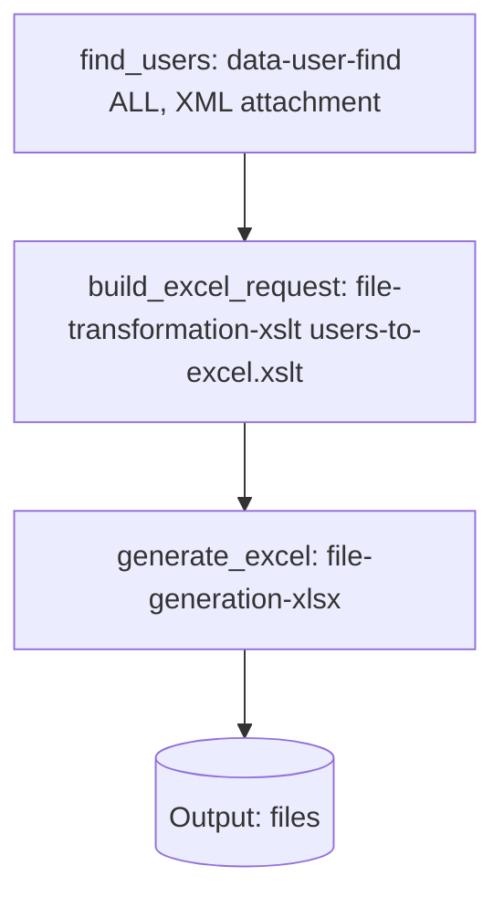

# List every user of the account in an Excel file

## Purpose

The smallest complete "find, transform, Excel" job: three tasks, no input, no variable. It lists every user of the account in a one-sheet workbook. Use it as the starting point for any report built from a `data-*-find` task.

Patterns shown:

- a `data-*-find` task rendering its result as XML (`outputs[].mediaType: application/xml`, `outputMode: ATTACHMENT`, read back as `${find_users.output.result.xml}`);
- the W3C `xpath-functions` vocabulary (`m:array/m:map/m:string[@key]`) addressed from XSLT 3.0;
- the `Generate-Excel` request grammar (`File-Name`, `Template-Key`, `Sheets/Sheet/Cells/Cell-Text`).

## Prerequisites

| Kind | Key | Notes |
| -- | -- | -- |
| Pipeline | any | Assigned in Settings when the job is imported. |
| Permissions | read users | The find runs with the credentials of the job execution. |

No table, no variable.

## User inputs

None.

## Flow

## Tasks

| # | Task reference | Catalog task | Role | Key inputs |
| -- | -- | -- | -- | -- |
| 1 | `find_users` | `data-user-find` | Every user, as an XML file | `findMode: ALL`, `outputs: [{mediaType: application/xml, outputMode: ATTACHMENT, outputKey: xml}]` |
| 2 | `build_excel_request` | `file-transformation-xslt` | Build the `Generate-Excel` request | `file: ${find_users.output.result.xml}`, `xslt: file://assets/users-to-excel.xslt` |
| 3 | `generate_excel` | `file-generation-xlsx` | Render the workbook | `request: ${build_excel_request.output.file}`, template `report` |

## Outputs

| Output | Source | Content |
| -- | -- | -- |
| `files` | `${generate_excel.output.files}` | The workbook `users.xlsx` |
| `users_found` | `${find_users.output.totalElements}` | Number of users |

## How to import

1. Package the folder as a `.job.zip` (VS Code: right-click `job.json` > **Package Job**; or `node <path-to-skills>/pl-job-build/scripts/package-job.js list-users-to-excel`).
2. In settings.product-live.com > **Data Factory > Jobs**, click **Add job**, drop the archive, choose a pipeline.
3. Click **Run** on the job and download the workbook from the execution.

## Adapting

- Another entity: replace `data-user-find` by any other find task (`data-account-find`, `data-partner-find`, `data-job-find`, ...) and the `m:string[@key = ...]` selections by the properties of that entity.
- JSON instead of XML: ask for `mediaType: application/json` and build the request with a `code-execute-javascript` task (see `export-job-executions-to-excel`).
- Filtering: switch to `findMode: REQUEST` with a `criteria` object (for example `{"type": "eq", "field": "status", "value": "ACTIVE"}`).
