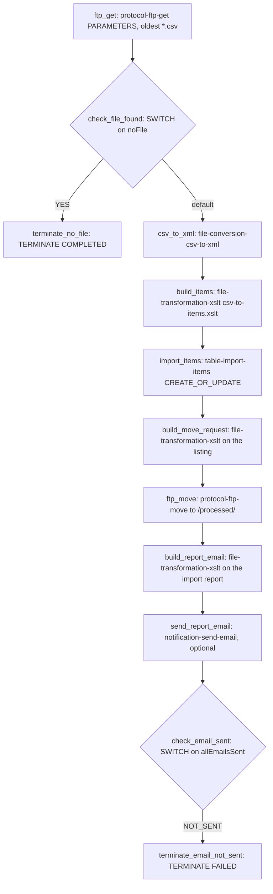

# Nightly import of a CSV file from an SFTP server

## Purpose

The canonical scheduled integration: every night, fetch the oldest CSV file waiting in the folder where an ERP drops them on an SFTP server, import its rows as items, move the file to a `processed` folder and email the import report. One file is processed per run and the oldest goes first, so a backlog (a weekend, a missed night) drains in order instead of leaving older files behind. When no file was dropped, the job completes with a message instead of failing, because an empty folder is a normal situation for a pickup.

Patterns shown:

- `protocol-ftp-get` in `PARAMETERS` mode with `sort: LAST_MODIFIED_ASC` and `maxFiles: 1` ("the oldest file matching a regex", the right order for an inbox whose processed files are moved away), with every connection setting read from global variables (secret password);
- a `SWITCH` with the `value-param` evaluator on the `noFile` output (`YES`/`NO`) and a `TERMINATE COMPLETED` branch;
- the CSV import pipeline of the `import-items-from-csv` example (`file-conversion-csv-to-xml`, header-driven XSLT, `table-import-items`);
- `protocol-ftp-move` with an `Ftp-Move` request generated by an XSLT from the `listing` output of the get task;
- an HTML email generated by an XSLT from the import report, with `pl-mail-to` and `pl-mail-subject` meta tags, sent by an `optional` `notification-send-email` task, followed by a `SWITCH` on `allEmailsSent` that fails the job when the email was not sent (nobody watches an unattended execution);
- a periodicity rule configured in Settings (not in `job.json`).

## Prerequisites

| Kind | Key | Notes |
| -- | -- | -- |
| Table | `PL_DEMO_PRODUCTS` | Created by the `demo-products-table` example (adapt the stylesheet for another table). |
| SFTP server | `/input/` and `/processed/` folders | Keep one folder per file type and few files per folder; the job reads `/input/` and moves to `/processed/` (whether the target folder must pre-exist is not documented: create it). |
| Global variable | `sftp_host` | Secret: no. DNS name or IP address. |
| Global variable | `sftp_port` | Secret: no. Usually `22` for SFTP. |
| Global variable | `sftp_username` | Secret: no. |
| Global variable | `sftp_password` | Secret: yes. For key-based authentication see Adapting. |
| Global variable | `import_report_recipients` | Secret: no. Email addresses separated by `;`, without spaces (the task splits on `;` and does not trim). |
| Pipeline | a dedicated one if possible | A nightly import should not queue behind ad-hoc jobs. |
| Periodicity | `0 2 * * *` | Configured in Settings on the job (see How to import). |

Variables are referenced with `${workflow.globalVariables.<key>}`, one variable per input value (a single template string cannot hold two global variables).

## User inputs

None: the job is scheduled. It can also be launched manually from Settings.

## Flow

## Tasks

| # | Task reference | Catalog task | Role | Key inputs |
| -- | -- | -- | -- | -- |
| 1 | `ftp_get` | `protocol-ftp-get` | Oldest CSV of `/input/` | `connection: SFTP`, host, port, username, password from variables, `mode: PARAMETERS`, `remoteFolder: /input/`, `sort: LAST_MODIFIED_ASC`, `filter: \.csv$`, `maxFiles: 1` |
| 2 | `check_file_found` | `switch` | Branch on `noFile` | `evaluatorType: value-param`, `expression: noFile`, `inputParameters.noFile: ${ftp_get.output.noFile}` |
| 2a | `terminate_no_file` | `terminate` | Complete with a message | `terminationStatus: COMPLETED`, `outputParameters.message` |
| 3 | `csv_to_xml` | `file-conversion-csv-to-xml` | CSV to grid | `file: ${ftp_get.output.file}`, `;` separator, `"` delimiter and escape |
| 4 | `build_items` | `file-transformation-xslt` | Grid to items document | `xslt: file://assets/csv-to-items.xslt` |
| 5 | `import_items` | `table-import-items` | Import | `request: ${build_items.output.file}`, `mode: CREATE_OR_UPDATE` |
| 6 | `build_move_request` | `file-transformation-xslt` | `Ftp-Move` request from the listing | `file: ${ftp_get.output.listing}`, `xslt: file://assets/build-move-request.xslt`, param `target_folder: /processed/` (a bare literal) |
| 7 | `ftp_move` | `protocol-ftp-move` | Archive the file | same connection variables, `request: ${build_move_request.output.file}` |
| 8 | `build_report_email` | `file-transformation-xslt` | HTML email from the report | `file: ${import_items.output.report}`, `xslt: file://assets/import-report-email.xslt`, params `recipients` (variable) and `listing` (`${ftp_get.output.listing}`) |
| 9 | `send_report_email` | `notification-send-email` | Send it | `mode: FILE`, `file: ${build_report_email.output.file}`, `optional: true` |
| 10 | `check_email_sent` | `switch` | Fail when the email was not sent | `evaluatorType: javascript`, `expression: $.sent == 'YES' ? 'SENT' : 'NOT_SENT'` (an empty value, when the optional task failed, also counts as not sent) |
| 10a | `terminate_email_not_sent` | `terminate` | Fail with a message | `terminationStatus: FAILED`, `outputParameters.message` and `import_report` |

Order matters: the file is moved only after the import task has run, and the email comes last so that a mail problem (the task is optional) never stops the move. Rejected items do not fail the import task: they are listed in the import report (its only output), so a file whose rows were all or partly rejected is still moved to `/processed/`; read the report (the email subject says `with errors`) and drop a corrected file in `/input/`. The job fails if the import task, the move or a transformation fails, or when the report email was not sent; the execution then stays visible in error in Settings.

## Outputs

| Output | Source | Content |
| -- | -- | -- |
| `imported_file` | `${ftp_get.output.file}` | The CSV file that was fetched |
| `items_file` | `${build_items.output.file}` | The generated items XML |
| `import_report` | `${import_items.output.report}` | The import report |
| `file_moved` | `${ftp_move.output.allFilesMoved}` | `YES`/`NO` |
| `email_sent` | `${send_report_email.output.allEmailsSent}` | `YES`/`NO` (empty when the task failed) |

When no file is found, only the `message` of `terminate_no_file` is displayed. When the email was not sent, the job ends `FAILED` and shows the `message` and `import_report` of `terminate_email_not_sent` instead of the outputs above.

## How to import

1. Create the five global variables in settings.product-live.com > **Data Factory > Variables**; mark `sftp_password` as protected.
2. Package the folder as a `.job.zip` (VS Code: right-click `job.json` > **Package Job**; or `node <path-to-skills>/pl-job-build/scripts/package-job.js nightly-sftp-csv-import`).
3. In settings.product-live.com > **Data Factory > Jobs**, click **Add job**, drop the archive, choose the pipeline; the visibility can stay **Hidden for all tables**.
4. Drop a CSV file in `/input/` on the server, click **Run** on the job and check the execution, the `/processed/` folder and the email.
5. Edit the job in Settings and add a periodicity rule with the cron expression `0 2 * * *` (every day at 02:00 UTC; cron schedules are evaluated in UTC, the minimum interval is 15 minutes, up to 3 rules per job). Set the job status to **Production** once validated.

## Adapting

- Another table: change the four parameters at the top of `assets/csv-to-items.xslt`.
- Key-based authentication: set `authenticationMethod: PUBLIC_KEY` and `privateKey: ${workflow.globalVariables.sftp_private_key}` (a protected variable is required for the key), remove `password`.
- Plain FTP or FTPS: change `connection` (and the port variable).
- Several files per night: raise `maxFiles` and switch `csv_to_xml` to `mode: FILES` with `files: ${ftp_get.output.files}`; the move request already handles every file of the listing. Keep `LAST_MODIFIED_ASC`: `LAST_MODIFIED_DESC` with `maxFiles: 1` would take the newest file every night and leave the older ones in `/input/` forever; use it only for a folder where the newest file supersedes the others (full snapshots).
- Alert when the import has errors: add a `SWITCH` after `import_items` on a count computed by an XSLT over the report (`count(/Report/Log[@type = 'error'])`), or keep the single email whose subject already says `with errors`.
- Delete instead of archive: replace the last FTP task by `protocol-ftp-delete`; moving is preferred when traceability matters.
