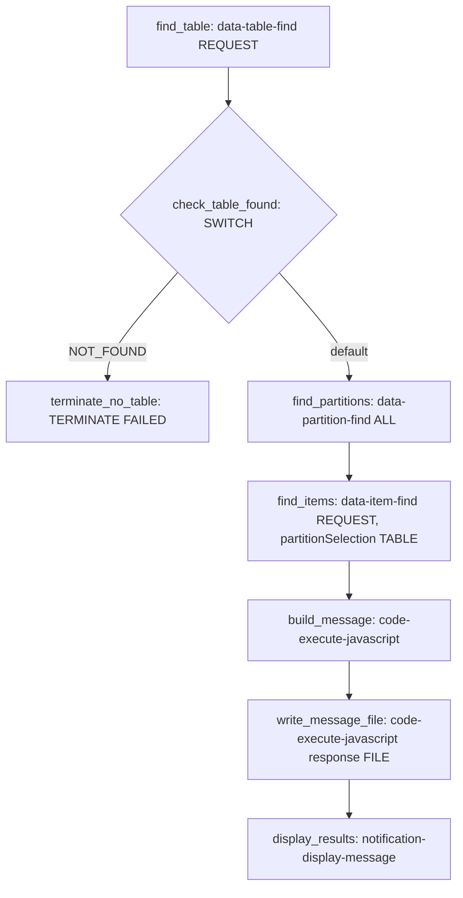

# Search items by option across all partitions

## Purpose

Finds, in every partition of a table at once, the items whose `LIFE_CYCLE` field holds the option chosen by the user, then shows a message with one link per partition that opens the grid already filtered on those items. A compact example of a guarded flow ending with an on-screen result.

Patterns shown:

- `SELECT` and `SCREEN` user inputs (`${workflow.input.screen.key}` reads a property of the selected screen object);
- resolving ids by chaining finds: `data-table-find` (by key) then `data-partition-find` (by `context.tableId`), indexing `result.json[0].id`;
- a `SWITCH` guard with the `javascript` evaluator and a `TERMINATE FAILED` branch carrying a user-facing message in its own `outputParameters`;
- `data-item-find` with `findOptions.partitionSelection: TABLE` and a `criteria` on an item field (`field: {target: item.fields, key: ...}`);
- an HTML message built by a script and shown by `notification-display-message`, with `https://app.product-live.com/redirect?...&filters=<base64 JSON>` access links (`btoa` is available in the sandbox).

## Prerequisites

| Kind | Key | Notes |
| -- | -- | -- |
| Table | `PL_DEMO_PRODUCTS` | Created by the `demo-products-table` example; the `LIFE_CYCLE` field is a single-select with options `NEW`, `RENEWED`, `ENDED`. |
| Pipeline | any | Assigned in Settings when the job is imported. |
| Launch origin | app.product-live.com | Needed for the `SCREEN` input and for the message to be displayed to the user. |

No variable.

## User inputs

| Key | Type | Required | Default | Description |
| -- | -- | -- | -- | -- |
| `lifeCycle` | `SELECT` (`SINGLE`) | yes | `NEW` | Option of `LIFE_CYCLE` to search for (`NEW`, `RENEWED`, `ENDED`) |
| `screen` | `SCREEN` | no | none | Screen used by the access links; when empty the links open the default screen |

## Flow

## Tasks

| # | Task reference | Catalog task | Role | Key inputs |
| -- | -- | -- | -- | -- |
| 1 | `find_table` | `data-table-find` | Resolve the table id | `findMode: REQUEST`, criteria `eq key PL_DEMO_PRODUCTS` |
| 2 | `check_table_found` | `switch` | Guard | `evaluatorType: javascript`, `expression: $.count > 0 ? 'OK' : 'NOT_FOUND'`, `count: ${find_table.output.totalElements}` |
| 2a | `terminate_no_table` | `terminate` | Stop in error with a message | `terminationStatus: FAILED`, `outputParameters.message` |
| 3 | `find_partitions` | `data-partition-find` | Partition ids and keys | `findMode: ALL`, `context.tableId: ${find_table.output.result.json[0].id}` |
| 4 | `find_items` | `data-item-find` | Items matching the option in every partition | `findOptions: {partitionSelection: TABLE, tableKey: PL_DEMO_PRODUCTS}`, criteria `eq` on `item.fields` / `LIFE_CYCLE` |
| 5 | `build_message` | `code-execute-javascript` | Count per partition, build HTML and links | `expressionFile: file://assets/build-message.js`, `data` with items, partitions, keys, screen |
| 6 | `write_message_file` | `code-execute-javascript` | Write the HTML to `message.html` | inline `expression`, `response: FILE` |
| 7 | `display_results` | `notification-display-message` | Show the message | `request: ${write_message_file.output.result}`, `height: ${build_message.output.result.messageHeight}` |

## Outputs

| Output | Source | Content |
| -- | -- | -- |
| `message` | `${display_results.output.message}` | The HTML message shown to the user |
| `items_found` | `${build_message.output.result.foundCount}` | Number of matching items |
| `partitions_with_matches` | `${build_message.output.result.partitionCount}` | Number of partitions holding matches |

When the guard terminates the job, only the `message` of the `TERMINATE` task is shown: a job ended by `TERMINATE` displays that task's `outputParameters`, not the job-level ones.

## How to import

1. Package the folder as a `.job.zip` (VS Code: right-click `job.json` > **Package Job**; or `node <path-to-skills>/pl-job-build/scripts/package-job.js search-items-by-option-across-partitions`).
2. In settings.product-live.com > **Data Factory > Jobs**, click **Add job**, drop the archive, choose a pipeline and set the visibility to the demo table.
3. In app.product-live.com, open the demo table, click **Actions > Search items by option across all partitions**, pick an option and run; click a link in the result message.

## Adapting

- Another table or field: change `PL_DEMO_PRODUCTS` in `find_table`, `find_items` and `build_message`, and `LIFE_CYCLE` in `find_items` and `build_message`; update the `options` of the `lifeCycle` input (the job receives the option key).
- Search on a free-text field: replace the `eq` criteria by `{"type": "search", "field": {...}, "value": "%text%"}` and the `SELECT` input by a `TEXT` input.
- Only the current partition: drop `findOptions` and pass `context.partitionId` from the launch context (`${workflow.input.context.view.partition.id}`).
- Email instead of an on-screen message: add `<meta name="pl-mail-to">` and `<meta name="pl-mail-subject">` to the HTML head in the script and send the file with `notification-send-email`.
