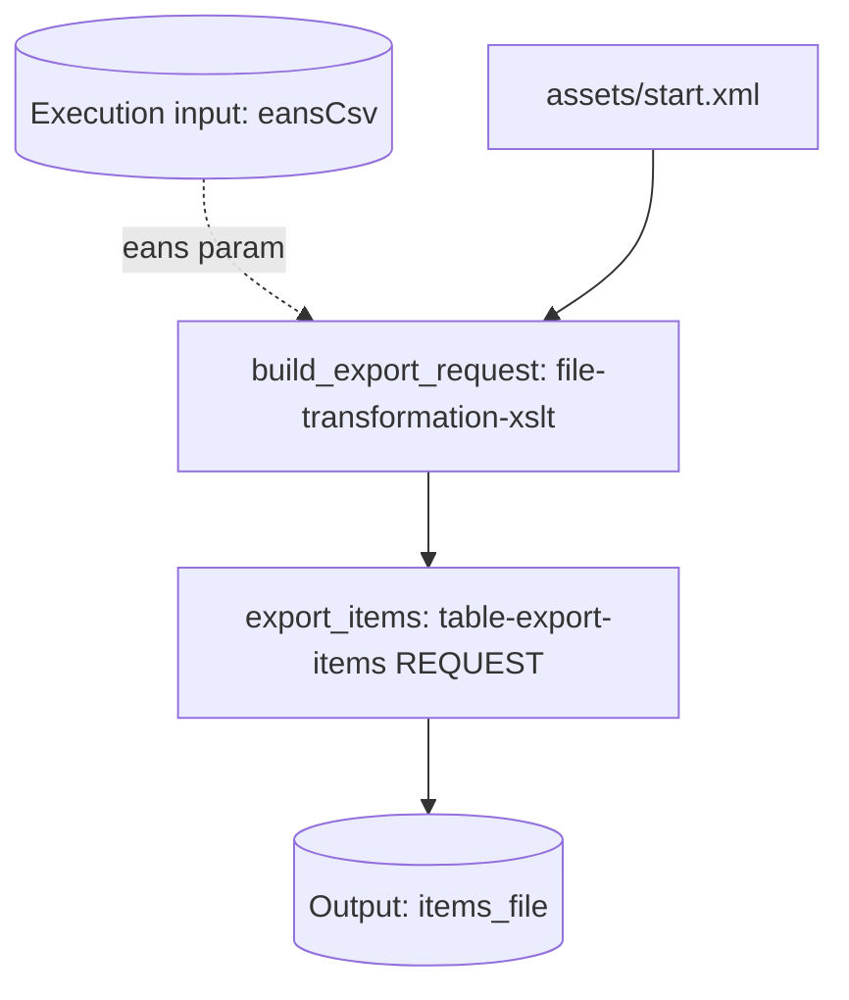

# Export items by EAN (import-ready XML file)

## Purpose

The callee of the "trigger a job and use its result" pair. It receives a comma-separated list of EANs in its execution input, exports the matching items of the `PRODUCTS` table and exposes the file in `outputParameters.items_file` so that the calling job can read it. It can also be launched from the API with `"input": {"eansCsv": "..."}`.

Patterns shown:

- a job with no `userInputs` that reads `${workflow.input.eansCsv}`: the key is supplied by the caller in `element.input` (or by the API in `input`);
- `table-export-items` in `REQUEST` mode with an `Items-Request` document (`Filters/Filter-Identifier[@key][@operator]/Value`);
- the dummy-source XSLT that generates a document from parameters only;
- the chaining contract: only `outputParameters` are readable by a caller.

## Prerequisites

| Kind | Key | Notes |
| -- | -- | -- |
| Table | `PRODUCTS` | Table of the owner account with identifier `EAN_13`. Adapt both keys to your table. |
| Pipeline | a pipeline distinct from the caller's | A job waiting for another job must not share its pipeline: pipelines run one job at a time, so the callee would wait for the caller forever. |

No variable, no user input.

## User inputs

None. Execution input expected: `eansCsv` (string, comma-separated EANs).

## Flow

## Tasks

| # | Task reference | Catalog task | Role | Key inputs |
| -- | -- | -- | -- | -- |
| 1 | `build_export_request` | `file-transformation-xslt` | Build the `Items-Request` filter | `file: file://assets/start.xml`, `xslt: file://assets/build-export-request.xslt`, `params: [{name: eans, select: ${workflow.input.eansCsv}}]` |
| 2 | `export_items` | `table-export-items` | Export the matching items | `tableKey: PRODUCTS`, `mode: REQUEST`, `request: ${build_export_request.output.file}`, `fileName: items.xml` |

## Outputs

| Output | Source | Content |
| -- | -- | -- |
| `items_file` | `${export_items.output.file}` | Items XML in the `table-export-items` format, directly importable with `table-import-items` |

## How to import

1. Package the folder as a `.job.zip` (VS Code: right-click `job.json` > **Package Job**; or `node <path-to-skills>/pl-job-build/scripts/package-job.js export-items-by-ean`).
2. On the account that owns the items, in settings.product-live.com > **Data Factory > Jobs**, click **Add job**, drop the archive, choose a pipeline that the calling job will not use, keep the visibility **Hidden for all tables** (the job is triggered, not launched by users).
3. Test it alone from the API: `POST /v1/data_factory/job_executions` with `{"jobId": "<id>", "info": {"title": "test"}, "input": {"eansCsv": "2000000000091,2000000000152"}}`, then read `output.items_file` on the execution.

## Adapting

- Another identifier: change `Filter-Identifier/@key` in the stylesheet.
- Return the items as JSON instead of XML: replace `table-export-items` by `data-item-find` with an `in` criteria and an `ATTACHMENT json` output, and expose `${find_items.output.result.json}`.
- More inputs from the caller: every key the caller puts in `element.input` is readable here as `${workflow.input.<key>}`.
