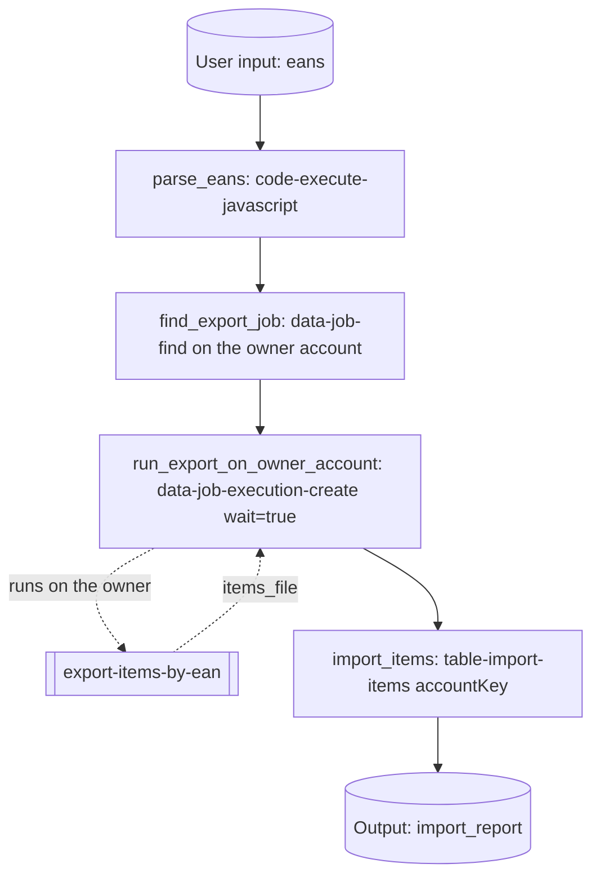

# Initialize my table from the owner account items

## Purpose

The caller of the "trigger a job and use its result" pair. A partner account that shares a table with the owner types a list of EANs; the job triggers `export-items-by-ean` on the owner account, waits for it, and imports the returned items on its own side of the shared table.

Patterns shown:

- `data-job-find` by job key and `data-job-execution-create` with `wait: true` and `waitOptions`, both calling the other account with its `apiKey`;
- passing values to the triggered job through `element.input` and reading its `outputParameters` back through `result.json[0].response.output.<key>`;
- a `TEXTAREA` input parsed by a script that fails the job (`throw`) when empty;
- `table-import-items` with `accountKey` on a shared table;

## Prerequisites

| Kind | Key | Notes |
| -- | -- | -- |
| Accounts | owner and partner | The owner account owns the table and both jobs; the partner account shares the table and runs this job. |
| Table | `PRODUCTS` | Shared between the two accounts; identifier `EAN_13`. |
| Job | `export-items-by-ean` | Imported on the owner account (see the sibling folder). |
| Global variable | `owner_api_key` | Secret: yes. API key of the owner account (created in the API tab of settings.product-live.com). An API key grants every action on its account: mark the variable as protected. |
| Global variable | `owner_account_key` | Secret: no. Account key of the owner, found in Settings > Network > Partners, used by `table-import-items` on the shared table. |
| Pipelines | two | The caller and the callee must run on different pipelines (a pipeline runs one job at a time; the caller would wait for a callee queued behind itself). |

Variables of a shared job are resolved on the owner's account: create both variables on the owner account, and the partner running the job gets the owner's values.

## User inputs

| Key | Type | Required | Default | Description |
| -- | -- | -- | -- | -- |
| `eans` | `TEXTAREA` | yes | empty | One EAN per line |

## Flow

## Tasks

| # | Task reference | Catalog task | Role | Key inputs |
| -- | -- | -- | -- | -- |
| 1 | `parse_eans` | `code-execute-javascript` | `eansCsv` and `count` from the textarea | `expressionFile: file://assets/parse-eans.js`, `data.eans: ${workflow.input.eans}` |
| 2 | `find_export_job` | `data-job-find` | Id of the export job on the owner account | `apiKey: ${workflow.globalVariables.owner_api_key}`, criteria `eq key export-items-by-ean` |
| 3 | `run_export_on_owner_account` | `data-job-execution-create` | Trigger and wait | `apiKey`, operation `{jobId, info.title, input.eansCsv}`, `wait: true`, `waitOptions: {pollingIntervalSeconds: 10, timeoutSeconds: 1800}` |
| 4 | `import_items` | `table-import-items` | Import on the shared table | `request: ${run_export_on_owner_account.output.result.json[0].response.output.items_file}`, `accountKey: ${workflow.globalVariables.owner_account_key}`, `mode: CREATE_OR_UPDATE` |

## Outputs

| Output | Source | Content |
| -- | -- | -- |
| `requested_eans_count` | `${parse_eans.output.result.count}` | Number of distinct EANs requested |
| `exported_items_file` | the callee's `items_file` | The file produced by the owner account |
| `import_report` | `${import_items.output.report}` | XML report of the import |

## How to import

1. Import `export-items-by-ean` on the owner account (its own README).
2. On the owner account, create the global variables `owner_api_key` (protected) and `owner_account_key`.
3. Package this folder as a `.job.zip` (VS Code: right-click `job.json` > **Package Job**; or `node <path-to-skills>/pl-job-build/scripts/package-job.js init-table-from-owner-items`).
4. On the owner account, in settings.product-live.com > **Data Factory > Jobs**, click **Add job**, drop the archive, choose a pipeline different from the export job's one, set the visibility to the shared table, and share the job with the partner accounts.
5. From the partner account, open the shared table in app.product-live.com, click **Actions > Initialize my table from the owner account items**, paste a few EANs and run.

## Adapting

- Same account instead of two: keep the structure and drop `accountKey` on `import_items`; the `apiKey` inputs can stay (an API key of that account, still in a protected variable) or be removed when the tasks may run with the job execution credentials (see the `data-job-find` and `data-job-execution-create` references).
- Lookup instead of `data-job-find`: `data-job-execution-create` operations accept `lookups` (`{"taskName": "data-job-find", "assign": "element.jobId", "entityKey": "export-items-by-ean"}`) that resolve the job id in the same call; see the task reference.
- Long exports: adjust `waitOptions.timeoutSeconds` within the documented wait budget and polling limits.
